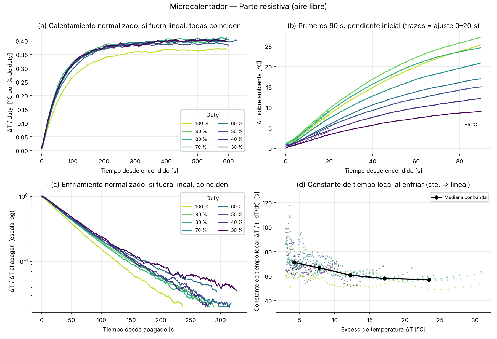
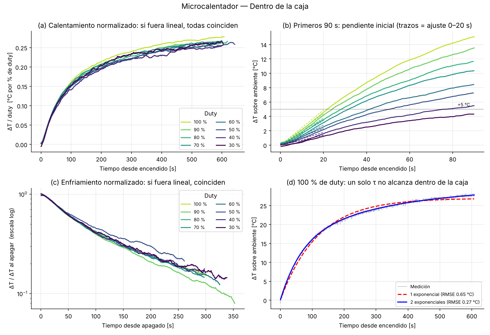
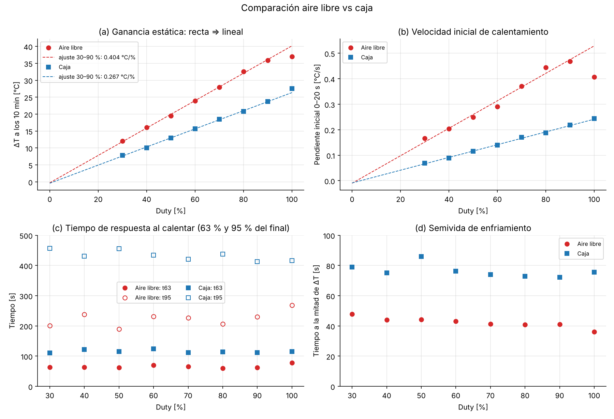

# Análisis de las curvas del microcalentador

Análisis de las curvas de calentamiento y enfriamiento medidas con duty de 30, 40, 50, 60, 70, 80, 90 y 100 %, en dos configuraciones:

- **Aire libre**: sensor sobre la parte resistiva del microcalentador (`Imagenes/grafica_temp.png`; datos en `Codigos/Matlab Modelo/Mediciones/`).
- **Dentro de la caja**: el microcalentador dentro de la caja, midiendo la temperatura dentro de ella (`Imagenes/caja.jpg`; datos en `Codigos/Matlab Modelo/Medicion caja/`).

Cada ensayo tiene unos 110 s de línea base, unos 10 min con el calentador encendido y 5–6 min de enfriamiento, con una muestra cada 0,5 s. Todas las temperaturas se expresan como **ΔT sobre la temperatura ambiente previa al encendido**. Hay una sola corrida por duty.

## Resumen

1. **Por qué las curvas suben a velocidades distintas.** Casi todo se explica por la amplitud: la pendiente inicial es proporcional al duty (aire libre: de 0,17 °C/s a 30 % a 0,47 °C/s a 90 %) y el tiempo en llegar al 63 % del valor final **no depende del duty**: ≈ 63 s al aire libre y ≈ 115 s en la caja. Un sistema lineal ya se comporta así.
2. **Por qué las curvas se enfrían a velocidades distintas.** En valores absolutos, lo más caliente se enfría más rápido (aire libre: 0,15 °C/s a 30 % contra 0,57 °C/s a 100 %), pero eso también lo hace un sistema lineal porque la velocidad es proporcional al exceso de temperatura. Lo que sí indica no linealidad es la velocidad **normalizada**.
3. **Aire libre: levemente no lineal.** La ganancia estática es constante (0,399 ± 0,005 °C por % de duty entre 30 y 90 %), pero el enfriamiento es más rápido cuanto más caliente: la semivida baja de 48 s (ΔT = 12 °C) a 36 s (ΔT = 37 °C), un 25 % menos (equivale a que la constante de tiempo de enfriamiento pase de 72 a 54 s). La tendencia con el duty es estadísticamente clara (p = 0,001).
4. **Aire libre, 100 % de duty: comportamiento distinto al resto.** Su ganancia es ≈ 8 % menor que la que predice la recta de 30–90 %, arranca más despacio que el de 90 % (pendiente inicial 0,41 contra 0,47 °C/s, cuando la proporcionalidad esperaría 0,52) y queda por debajo de la curva de 90 % durante los primeros 3 min. Con los datos actuales no se puede decidir si es una no linealidad real o una diferencia entre corridas (ver sección 4).
5. **Caja: no se detecta no linealidad en amplitud**, con la resolución de estos datos: ganancia 0,260 ± 0,005 °C/%, semivida de enfriamiento 72–79 s, con 86 s en una corrida (sin tendencia con el duty, p = 0,19). **Pero no es un sistema de un solo τ**: hay una escala rápida (≈ 60–80 s) y otra lenta (≈ 300–550 s), y a los 10 min todavía no llegó al régimen.
6. **Tiempos de respuesta del transitorio** (valores típicos para 30–90 %): subida de 10 a 90 % en 140–160 s al aire libre y 290–340 s en la caja; 95 % del valor final en 190–240 s y 410–460 s respectivamente.

## Cómo se analizó

- **Eventos.** El instante de encendido `t_on` y el de apagado `t_off` se estimaron de los propios datos (ajuste de un cambio de régimen), no con los vectores del `.m`. En varias corridas difieren (sección 4).
- **Calentamiento:** ajuste de un exponencial de primer orden `ΔT(t) = K·(1 − e^(−t/τ))` (el mismo modelo de `ajustar_modelo_heat.m`) y de dos exponenciales, más medidas que no dependen del modelo: pendiente inicial (regresión en 0–20 s), tiempo a +5 °C, t63, subida 10–90 % y t95, sobre la curva suavizada (~10 s).
- **Enfriamiento:** ajuste `ΔT(t) = ΔT₀·e^(−t/τ_off)` con la temperatura ambiente previa como asíntota y, para ver cuánto depende de ese supuesto, con la asíntota libre. Medidas sin modelo: velocidad inicial, **semivida** (tiempo en que ΔT cae a la mitad) y fracción de ΔT que queda a 60 y 120 s.
- **Pruebas de linealidad.** Si el sistema fuera lineal y la potencia proporcional al duty: (1) ΔT a los 10 min / duty sería constante; (2) las curvas de calentamiento normalizadas (ΔT/duty) y de enfriamiento normalizadas (ΔT/ΔT₀) coincidirían; (3) τ, t63 y la semivida no dependerían del duty; (4) el enfriamiento normalizado sería la imagen espejo (1 − calentamiento normalizado); (5) la constante de tiempo local al enfriar, ΔT/(−dT/dt), sería la misma a cualquier temperatura (solo se usa al aire libre, donde se alcanza el ambiente).
- **Supuesto sin verificar:** potencia proporcional al duty (tensión de alimentación fija y resistencia constante). No se midió la corriente ni la tensión del calentador.

## 1. Parte resistiva al aire libre



### Calentamiento

| Duty [%] | ΔT a 10 min [°C] | ΔT/duty [°C/%] | Pend. inicial 0–20 s [°C/s] | Tiempo a +5 °C [s] | τ_on (1 exp.) [s] | t63 [s] | Subida 10–90 % [s] | t95 [s] |
|---:|---:|---:|---:|---:|---:|---:|---:|---:|
| 100 | 37,0 | 0,370 | 0,407 | 11,3 | 77,6 | 77,8 | 184 | 268 |
| 90 | 35,9 | 0,399 | 0,468 | 9,6 | 62,9 | 62,2 | 158 | 230 |
| 80 | 32,6 | 0,408 | 0,444 | 10,5 | 61,9 | 60,1 | 157 | 207 |
| 70 | 27,9 | 0,399 | 0,371 | 13,4 | 66,2 | 65,1 | 152 | 226 |
| 60 | 23,9 | 0,398 | 0,290 | 17,3 | 72,4 | 70,6 | 161 | 231 |
| 50 | 19,5 | 0,389 | 0,249 | 18,6 | 61,5 | 62,0 | 141 | 190 |
| 40 | 16,0 | 0,401 | 0,204 | 23,8 | 62,8 | 62,9 | 154 | 238 |
| 30 | 12,0 | 0,400 | 0,166 | 33,6 | 63,6 | 63,7 | 152 | 201 |

- **Velocidad:** la pendiente inicial por % de duty está entre 0,0048 y 0,0056 °C/s para 30–90 % (constante dentro de ±7 %) y baja a 0,0041 °C/s a 100 %. Para subir 5 °C se necesitan 34 s a 30 % y ≈ 10–11 s a 90–100 %.
- **Tiempo de respuesta:** τ_on y t63 son ≈ 60–66 s para 30–90 % (la corrida de 60 % da 71–72 s) y no tienen tendencia con el duty (pendiente de τ_on contra duty: +0,003 ± 0,08 s/%, p = 0,97). La subida 10–90 % toma 141–161 s y llegar al 95 % lleva 190–240 s. El valor de 100 % (78 s, 184 s, 268 s) es claramente más lento.
- **Forma de la curva:** el modelo de un exponencial deja un error de 0,25–0,5 °C (RMSE), contra 0,24–0,32 °C con dos exponenciales; el piso de ruido es ≈ 0,24 °C (el RMSE a bajo duty). Es una buena descripción, algo peor a 80–100 % de duty.
- **Colapso (panel a de la figura):** las curvas ΔT/duty de 30–90 % coinciden dentro de ±5 % (salvo 60 % a 20–60 s: −10 % y −6 %). La de 100 % queda 22 % por debajo a los 20 s y 8 % por debajo en la meseta.

### Enfriamiento

| Duty [%] | ΔT al apagar [°C] | Veloc. inicial [°C/s] | Semivida [s] | Queda a los 60 s [fracción] | Tiempo a 10 % restante [s] | τ_off, T_amb fija [s] | τ_off, asíntota libre [s] |
|---:|---:|---:|---:|---:|---:|---:|---:|
| 100 | 37,1 | 0,573 | 36,0 | 0,317 | 127 | 53,8 | 51,5 |
| 90 | 35,9 | 0,487 | 41,1 | 0,370 | 150 | 63,1 | 58,2 |
| 80 | 32,7 | 0,455 | 40,7 | 0,367 | 145 | 61,8 | 57,7 |
| 70 | 28,3 | 0,400 | 41,2 | 0,372 | 153 | 65,1 | 60,2 |
| 60 | 24,1 | 0,316 | 43,1 | 0,383 | 176 | 69,1 | 58,5 |
| 50 | 19,3 | 0,247 | 44,1 | 0,404 | 158 | 66,6 | 62,0 |
| 40 | 16,0 | 0,227 | 43,9 | 0,395 | 156 | 66,5 | 62,8 |
| 30 | 11,9 | 0,153 | 47,9 | 0,415 | 169 | 72,5 | 61,8 |

- **Velocidad:** la velocidad inicial va de 0,15 a 0,57 °C/s, proporcional a ΔT₀ como corresponde a cualquier sistema lineal.
- **Velocidad normalizada (esto es lo que mide la no linealidad):** la semivida baja de 47,9 s (30 %) a 36,0 s (100 %) y la fracción que queda a los 60 s baja de 0,415 a 0,317. Para un sistema lineal ambas serían constantes. La pendiente de la semivida contra el duty es −0,13 ± 0,02 s/% (p = 0,001), y −0,11 ± 0,02 s/% (p = 0,004) si se excluye 100 %. La asíntota libre hace menos pronunciada la tendencia de τ_off (62 → 51 s) pero no la elimina.
- **Constante de tiempo local (panel d):** al enfriar, sale ≈ 71 s cuando ΔT está entre 3 y 6 °C, ≈ 61 s entre 10 y 15 °C y ≈ 57 s entre 20 y 30 °C. Esto es compatible con pérdidas que crecen con la temperatura (convección natural y radiación), aunque el experimento no permite separar ese efecto de otros. El exponente local en −dT/dt ∝ ΔT^n resulta entre 1,08 y 1,27 según la corrida (n = 1 sería lineal).
- **Tiempo de respuesta:** llegar a 10 % del ΔT inicial toma 127 s a 100 % y 169 s a 30 %.

### ¿Es lineal?

| Prueba | Resultado al aire libre |
|---|---|
| ΔT a 10 min / duty | 0,399 ± 0,005 °C/% en 30–90 % (±1,4 %; R² = 0,9986); 100 %: 0,370 (−7 %) |
| Calentamiento normalizado | coincide ±5 % en 30–90 %; 100 % se aparta (−22 % a 20 s, −8 % en la meseta) |
| τ_on, t63 contra duty | sin tendencia en 30–90 % (p > 0,7) |
| Semivida y τ_off contra duty | **tendencia clara** (p ≤ 0,02, incluso sin 100 %) |
| Espejo calentamiento/enfriamiento | RMS ≤ 0,03 de la escala en 30–90 %; 100 %: 0,09 (máx. 0,15) |

**Conclusión:** en 30–90 % el calentamiento es prácticamente lineal y el enfriamiento muestra una no linealidad leve y sistemática (≈ 25–35 % de variación en el tiempo de enfriamiento entre 12 y 37 °C de exceso). El sistema no es fuertemente no lineal. A 100 % hay una desviación mayor.

## 2. Dentro de la caja



### Calentamiento

| Duty [%] | ΔT a 10 min [°C] | ΔT/duty [°C/%] | Pend. inicial 0–20 s [°C/s] | Tiempo a +5 °C [s] | τ_on (1 exp.) [s] | t63 [s] | Subida 10–90 % [s] | t95 [s] |
|---:|---:|---:|---:|---:|---:|---:|---:|---:|
| 100 | 27,6 | 0,276 | 0,244 | 21,7 | 117,7 | 115,0 | 322 | 416 |
| 90 | 23,8 | 0,264 | 0,218 | 23,9 | 113,6 | 111,9 | 320 | 413 |
| 80 | 20,8 | 0,260 | 0,187 | 28,1 | 113,8 | 113,8 | 316 | 438 |
| 70 | 18,5 | 0,264 | 0,171 | 31,7 | 113,4 | 111,6 | 315 | 421 |
| 60 | 15,7 | 0,261 | 0,139 | 41,4 | 125,4 | 123,8 | 343 | 434 |
| 50 | 12,9 | 0,258 | 0,116 | 50,6 | 119,5 | 115,3 | 337 | 455 |
| 40 | 10,0 | 0,251 | 0,089 | 76,0 | 121,0 | 122,0 | 326 | 431 |
| 30 | 7,8 | 0,261 | 0,069 | 113,7 | 116,7 | 111,2 | 287 | 457 |

- **Velocidad:** la pendiente inicial es proporcional al duty (0,0022–0,0024 °C/s por %, de 0,069 a 0,244 °C/s) y aquí **100 % no es anómalo**. Para subir 5 °C hacen falta 22 s a 100 % y 114 s a 30 % (a 30 % el ΔT final es de solo 7,8 °C).
- **Tiempo de respuesta:** t63 ≈ 111–124 s sin tendencia con el duty; subida 10–90 % de 287 a 343 s; t95 de 413 a 457 s. Con 600 s de calentamiento no se llega al régimen estacionario: la curva sigue subiendo al apagar.
- **Colapso (panel a):** ΔT/duty coincide dentro de ±8 % en todos los tiempos (100 % queda 5–8 % por encima).

**Un solo τ no alcanza (panel d).** El error del ajuste de un exponencial crece con la amplitud (0,27 a 0,65 °C) y es sistemático, mientras que con dos exponenciales cae al nivel del ruido (0,23–0,27 °C):

| Duty [%] | RMSE 1 exp. [°C] | RMSE 2 exp. [°C] | τ rápido [s] | τ lento [s] | Peso del rápido |
|---:|---:|---:|---:|---:|---:|
| 100 | 0,65 | 0,27 | 67 | 336 | 0,53 |
| 90 | 0,61 | 0,27 | 61 | 305 | 0,51 |
| 80 | 0,54 | 0,26 | 65 | 352 | 0,55 |
| 70 | 0,51 | 0,26 | 62 | 343 | 0,52 |
| 60 | 0,49 | 0,25 | 64 | 449 | 0,47 |
| 50 | 0,42 | 0,26 | 56 | 288 | 0,46 |
| 40 | 0,32 | 0,24 | 77 | 552 | 0,57 |
| 30 | 0,27 | 0,23 | 79 | 550 | 0,61 |

El τ rápido (56–79 s) es del orden del τ del calentador al aire libre; el lento (≈ 290–550 s) está mal determinado porque la medición dura apenas 1–2 veces ese valor. Con el modelo de dos exponenciales el valor final sería 7–18 % mayor que el ΔT medido a los 10 min (estimación poco precisa).

### Enfriamiento

| Duty [%] | ΔT al apagar [°C] | Veloc. inicial [°C/s] | Semivida [s] | Queda a los 60 s [fracción] | Queda a los 120 s [fracción] | τ_off, T_amb fija [s] | τ_off, asíntota libre [s] | Exceso al final del registro [°C] |
|---:|---:|---:|---:|---:|---:|---:|---:|---:|
| 100 | 27,7 | 0,238 | 75,7 | 0,567 | 0,366 | 139 | 86 | 4,5 |
| 90 | 24,0 | 0,207 | 72,2 | 0,553 | 0,342 | 129 | 93 | 2,2 |
| 80 | 21,0 | 0,180 | 72,9 | 0,555 | 0,366 | 138 | 84 | 3,3 |
| 70 | 18,6 | 0,153 | 73,9 | 0,565 | 0,356 | 134 | 84 | 2,9 |
| 60 | 15,8 | 0,131 | 76,2 | 0,576 | 0,380 | 141 | 91 | 2,2 |
| 50 | 13,1 | 0,112 | 86,0 | 0,596 | 0,407 | 160 | 87 | 3,0 |
| 40 | 10,2 | 0,099 | 75,0 | 0,559 | 0,353 | 139 | 81 | 1,7 |
| 30 | 8,0 | 0,054 | 78,8 | 0,558 | 0,376 | 148 | 89 | 1,2 |

- **Velocidad normalizada:** la semivida es 72–79 s en casi todas (86 s a 50 %, la corrida con el apagado más tardío) y no depende del duty de forma detectable (pendiente −0,09 ± 0,06 s/%, p = 0,19). La fracción que queda a los 60 s es 0,553–0,596 y a los 120 s es 0,34–0,41, sin tendencia.
- **El τ_off no se puede dar con un solo valor.** Si la asíntota es la temperatura previa al encendido, el ajuste da 129–160 s; si se deja libre, 81–93 s. La diferencia es que al final del registro (260–353 s) la caja sigue **1,2 a 4,5 °C por encima** de la temperatura inicial (entre 9 y 23 % del ΔT al apagar, en todos los duty), es decir, la cola lenta no terminó de decaer. Hace falta registrar el enfriamiento bastante más tiempo.
- **Tiempo de respuesta:** dentro del registro solo la corrida de 90 % llegó a que quede un 10 % de ΔT (a los 329 s); en las demás todavía quedaba más.

### ¿Es lineal?

| Prueba | Resultado en la caja |
|---|---|
| ΔT a 10 min / duty | 0,260 ± 0,005 °C/% en 30–90 % (±1,7 %; R² = 0,9990); 100 %: 0,276 (+6 %) |
| Calentamiento normalizado | coincide ±8 % |
| t63 contra duty | sin tendencia (p = 0,56) |
| Semivida contra duty | sin tendencia detectable (p = 0,19) |
| Espejo calentamiento/enfriamiento | RMS 0,009–0,047 de la escala (mayor a bajo duty, donde un ruido de ≈ 0,25 °C pesa ≈ 3 % sobre 8 °C) |

**Conclusión:** con estos datos la caja es compatible con un sistema lineal en amplitud, pero de orden mayor a uno (dos escalas de tiempo). No se afirma que sea lineal: el enfriamiento está mal resuelto por la cola lenta y la resolución es de unos pocos %. Como el sensor mide el aire de la caja y no la parte resistiva, es posible que la caja filtre (suavice) el comportamiento del calentador, pero eso no se puede comprobar con estos datos.

## 3. Comparación



| | Aire libre (30–90 %) | Caja (30–90 %) |
|---|---|---|
| ΔT a 10 min por % de duty | 0,399 °C/% | 0,260 °C/% (0,65 veces) |
| Pendiente inicial por % de duty | ≈ 0,0052 °C/s | ≈ 0,0023 °C/s (0,44 veces) |
| t63 | ≈ 63 s | ≈ 114 s (1,8 veces) |
| Subida 10–90 % | 141–161 s | 287–343 s |
| t95 | 190–238 s | 413–457 s |
| Semivida de enfriamiento | 41–48 s (36 s a 100 %) | 72–79 s |
| Escalas de tiempo | una dominante, ≈ 60 s | dos: ≈ 60–80 s y ≈ 300–550 s |

El sensor dentro de la caja ve un calentamiento menor y casi dos veces más lento que el sensor sobre la parte resistiva. Es coherente con que **la lectura depende de dónde se ponga el sensor**, pero este análisis solo tiene una posición por configuración, así que no lo demuestra: habría que medir con el sensor en varias posiciones.

## 4. Puntos a revisar

**La corrida de 100 % al aire libre.** Es más lenta que la de 90 % hasta los ≈ 185 s (diferencia máxima −2,3 °C a los 59 s), su pendiente inicial es 0,87 veces la de 90 % (esperable: 1,11) y su ganancia es ≈ 8 % menor. Al principio las pérdidas difícilmente expliquen esa diferencia, porque el calentador aún está cerca de la temperatura ambiente. O la potencia efectiva no creció en proporción al duty, o hubo una diferencia entre corridas (posición del sensor, corrientes de aire, estado inicial). En la caja el 100 % sí es proporcional al resto; si la alimentación fue la misma en ambas series, eso haría menos probable un límite eléctrico. Repetir el 100 % al aire libre despejaría la duda.

**Los vectores `t_on_vec` / `t_off_vec` de `main_comparacion_duty.m` no coinciden con los datos en varias corridas.** El script define un solo juego de vectores (y hoy procesa `archivos2`, la caja). Abajo, esos valores y los medidos en cada serie:

| Duty [%] | t_on en el .m [s] | t_on medido, libre | t_on medido, caja | t_off en el .m [s] | t_off medido, libre | t_off medido, caja |
|---:|---:|---:|---:|---:|---:|---:|
| 100 | 110 | 113 | 109 | 715 | 707 | 717 |
| 90 | 108 | 110 | 110 | 704 | 708 | 709 |
| 80 | 104 | 113 | 109 | 709 | 709 | 728 |
| 70 | 105 | 109 | 109 | 709 | 709 | 709 |
| 60 | 101 | 103 | 109 | 708 | 731 | 705 |
| 50 | 107 | 107 | 106 | 740 | 707 | 749 |
| 40 | 103 | 112 | 105 | 709 | 705 | 709 |
| 30 | 104 | 108 | 105 | 701 | 701 | 709 |

Las diferencias mayores son el apagado de 50 % al aire libre (740 s en el `.m`, ≈ 707 s medido), el de 60 % al aire libre (708 s en el `.m`, ≈ 731 s medido) y el de 80 % en la caja (709 s en el `.m`, ≈ 728 s medido). Con un `t_off` demasiado tarde, el tramo de "calentamiento" incluye parte del enfriamiento; con uno demasiado temprano, el tramo de "enfriamiento" incluye parte de la meseta. Los `t_on` del `.m` están hasta 9 s antes del inicio medido y eso tiende a alargar τ_on.

**Concordancia con las tablas de MATLAB** (`Imagenes/modelo_caja.jpg` y `Imagenes/funcion transferencia.jpg`): los ajustes de este análisis reproducen K_on dentro del 1,3 % y τ_on dentro de ≈ 15 % (al aire libre, 15,1 % como máximo; en la caja, 9,6 %). Las diferencias más grandes de τ_on se dan donde el `t_on` del `.m` se adelanta más.

## 5. Limitaciones

- **Una corrida por duty.** No se puede separar el efecto del duty de la variación entre corridas. Los errores estándar que da el ajuste (0,15–0,3 s para τ_on al aire libre y 0,6–0,8 s en la caja) son mucho menores que la variación de τ_on entre duty (61–78 s y 113–125 s, sin patrón claro con el duty), así que subestiman la incertidumbre real; diferencias de menos de ≈ 5–10 % no son concluyentes.
- **Potencia no medida.** "Duty" no es necesariamente proporcional a la potencia (tensión de alimentación, resistencia del calentador y su variación con la temperatura).
- **ΔT a los 10 min no es el valor estacionario**, sobre todo en la caja (ver sección 2). Todas las corridas comparten ese tiempo, así que la comparación entre duty es consistente, pero el valor absoluto subestima la ganancia en régimen.
- **Enfriamiento corto en la caja:** 260–353 s, comparable o menor que el τ lento (≈ 300–550 s), insuficiente para fijar τ_off y la asíntota.
- Los archivos de 10 % y 20 % de duty existen en el repositorio y no se incluyeron en este análisis.

## 6. Posibles ampliaciones

1. Incluir las mediciones de 10 y 20 % de duty para extender el rango de amplitud hacia abajo.
2. Repetir al menos 100 % y otro duty intermedio varias veces, para medir la variación entre corridas.
3. Medir tensión y corriente del calentador y expresar las ganancias en °C/W y la capacidad térmica en J/°C.
4. Ensayos con escalones pequeños alrededor de una temperatura de trabajo (por ejemplo ±5 % de duty sobre 50 %), que es lo que realmente necesita el diseño del controlador de temperatura.
5. Registrar el enfriamiento de la caja durante 15–20 min, y repetir con el sensor en distintas posiciones.
6. Corregir en `main_comparacion_duty.m` los `t_on`/`t_off` (o detectarlos automáticamente a partir de los datos).

## Cómo reproducir

```
python "Codigos/Python Analisis/figuras_analisis.py" . Analisis
```

Requiere Python 3 con `numpy`, `scipy` y `matplotlib`. Se ejecuta desde la raíz del repositorio y regenera `Analisis/figuras/` y `Analisis/tablas/` (tablas completas en CSV y `resumen_linealidad.txt` con las pruebas de linealidad). `analisis_curvas.py` contiene los cálculos y `figuras_analisis.py` las figuras y tablas.
