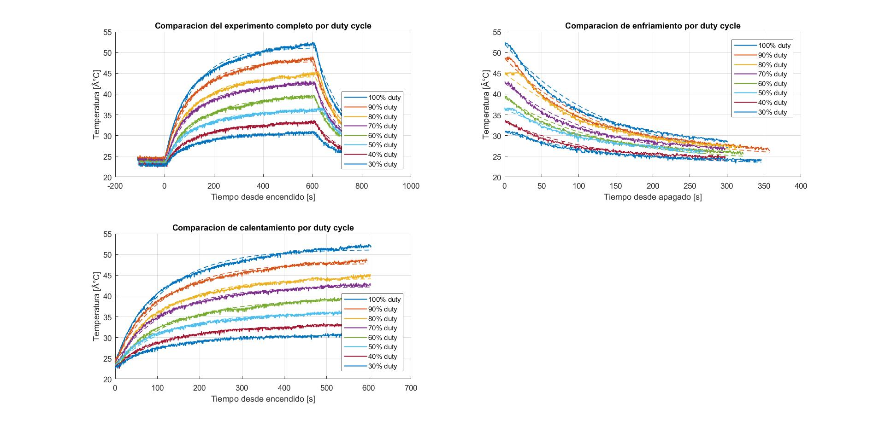
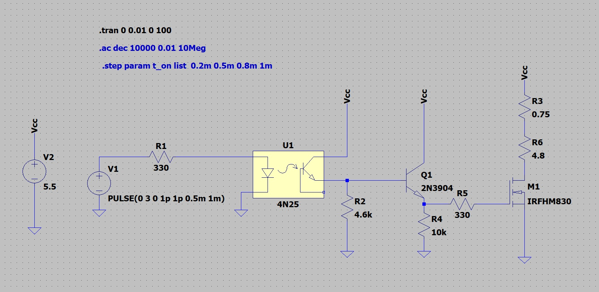
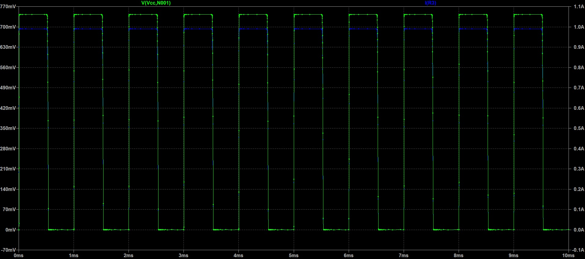

# Microcalentador para la detección de arsina

Microcalentador con control de temperatura para un sensor de arsina. El repositorio reúne el firmware y los scripts, el diseño de la placa, las simulaciones y las mediciones.

| Carpeta | Contenido |
|---|---|
| `Codigos/` | Firmware del controlador, scripts de MATLAB para identificar el modelo y scripts de Python para el análisis de curvas |
| `Kicad/` | Esquemático y placa del controlador de temperatura |
| `LTspice/` | Simulaciones |
| `Analisis/` | Informe completo, figuras y tablas del análisis de las curvas |
| `Imagenes/`, `Hoja de datos/`, `paper/` | Fotos, gráficas y documentación |

## Respuesta transitoria del microcalentador (encendido y apagado)

Se midió la temperatura del microcalentador con duty de 30, 40, 50, 60, 70, 80, 90 y 100 %: unos 10 min encendido y luego el enfriamiento, en dos configuraciones:

- **Aire libre:** sensor sobre la parte resistiva.
- **Dentro de la caja:** el microcalentador dentro de una caja, midiendo la temperatura de su interior.

**Parte resistiva, aire libre**


**Dentro de la caja**



### Conclusiones del transitorio

**Encendido.** Las curvas suben a velocidades distintas porque cada duty apunta a una temperatura final distinta: cuanto mayor es el duty, más alta es la temperatura que se busca alcanzar y más rápido sube al principio. Sin embargo, el tiempo que tarda el microcalentador en responder es esencialmente el mismo sin importar el duty: todas las curvas tienen la misma forma y lo único que cambia es su escala. Por eso, al aire libre, el calentamiento se describe bien como un sistema de primer orden con una única constante de tiempo, y el aumento final de temperatura crece de forma proporcional al duty. Dentro de la caja el sensor ve un calentamiento menor y bastante más lento, y la respuesta ya no tiene un solo tiempo característico: hay una parte rápida, parecida a la del calentador al aire libre, y otra mucho más lenta que sigue evolucionando cuando se apaga el calentador, de modo que nunca llega a un régimen estacionario durante la medición.

**Apagado.** Al apagar, lo más caliente se enfría más rápido en valores absolutos, pero eso también le pasa a cualquier sistema lineal, así que por sí solo no demuestra no linealidad. Lo que sí la muestra es comparar las curvas normalizadas: al aire libre, cuanto más caliente está el microcalentador, más rápido se enfría en proporción, algo esperable si las pérdidas de calor hacia el ambiente crecen con la temperatura. Dentro de la caja no se ve esa dependencia, y el enfriamiento tiene una cola lenta: pasados varios minutos desde el apagado la temperatura todavía no volvió a la inicial, por lo que el registro es corto para fijar bien su constante de tiempo de enfriamiento.

**¿Es no lineal?** Levemente. En el rango medio de duty el calentamiento es prácticamente lineal, y la no linealidad aparece sobre todo en el enfriamiento al aire libre, de forma leve y sistemática. Dentro de la caja no se detecta con la resolución de estos datos, aunque eso no alcanza para afirmar que sea lineal. En la práctica, un modelo lineal de primer orden sirve como primera aproximación del calentador al aire libre, pero conviene tener presente que su respuesta de enfriamiento cambia algo con la temperatura.

**A tener en cuenta.** La corrida de mayor duty al aire libre se aparta del resto: arranca más lenta que la de un duty menor, y con los datos actuales no se puede saber si es un efecto real o una diferencia entre corridas. Hay una sola corrida por duty y no se midió la potencia entregada, que se supone proporcional al duty; repetir las mediciones y registrar tensión y corriente permitiría confirmarlo.

### Función de transferencia

Cada curva se ajustó con un modelo de primer orden (`Codigos/Matlab Modelo/construir_tf.m`):

- Encendido: `G_on(s) = K_on / (τ_on·s + 1)`, con `K_on` en °C (el aumento final de temperatura para ese duty) y `τ_on` en s.
- Apagado: `G_off(s) = 1 / (τ_off·s + 1)`, con `τ_off` en s.

**Parte resistiva, aire libre**

| Duty [%] | K_on [°C] | τ_on [s] | τ_off [s] | T_amb [°C] | G_on(s) |
|---:|---:|---:|---:|---:|---|
| 100 | 36,693 | 81,355 | 56,548 | 23,658 | `36,693 / (81,355·s + 1)` |
| 90 | 35,373 | 65,085 | 66,869 | 23,483 | `35,373 / (65,085·s + 1)` |
| 80 | 32,303 | 72,815 | 63,468 | 23,336 | `32,303 / (72,815·s + 1)` |
| 70 | 27,813 | 71,551 | 65,861 | 23,248 | `27,813 / (71,551·s + 1)` |
| 60 | 23,95 | 74,366 | 70,117 | 22,567 | `23,95 / (74,366·s + 1)` |
| 50 | 19,382 | 61,978 | 68,129 | 22,578 | `19,382 / (61,978·s + 1)` |
| 40 | 15,919 | 73,312 | 66,356 | 22,53 | `15,919 / (73,312·s + 1)` |
| 30 | 11,922 | 67,811 | 72,854 | 22,109 | `11,922 / (67,811·s + 1)` |

**Dentro de la caja**

| Duty [%] | K_on [°C] | τ_on [s] | τ_off [s] | T_amb [°C] | G_on(s) |
|---:|---:|---:|---:|---:|---|
| 100 | 26,89 | 116,03 | 130,21 | 24,323 | `26,89 / (116,03·s + 1)` |
| 90 | 23,252 | 115,96 | 125,4 | 24,625 | `23,252 / (115,96·s + 1)` |
| 80 | 20,22 | 120,34 | 148,24 | 24,032 | `20,22 / (120,34·s + 1)` |
| 70 | 18,15 | 119,87 | 125,55 | 24,134 | `18,15 / (119,87·s + 1)` |
| 60 | 15,551 | 138,71 | 131,22 | 23,7 | `15,551 / (138,71·s + 1)` |
| 50 | 12,525 | 117,3 | 154,28 | 23,328 | `12,525 / (117,3·s + 1)` |
| 40 | 9,8572 | 124,09 | 126,49 | 23,1 | `9,8572 / (124,09·s + 1)` |
| 30 | 7,6401 | 116,94 | 140,92 | 22,901 | `7,6401 / (116,94·s + 1)` |

Son los valores que entrega `main_comparacion_duty.m`. En la caja el modelo de primer orden es una aproximación: la curva tiene dos escalas de tiempo, y los `t_on`/`t_off` que usa el script no coinciden con los datos en varias corridas (ver la sección 4 del informe).

El análisis completo, con el método, las tablas por duty y las limitaciones, está en [`Analisis/curvas_microcalentador.md`](Analisis/curvas_microcalentador.md). Para regenerar figuras y tablas:

```
python "Codigos/Python Analisis/figuras_analisis.py" . Analisis
```

## Etapa de amplificación de corriente

El ESP32 genera la señal PWM (en el firmware: GPIO 25, 1 kHz, 8 bits de resolución), pero no puede entregar la corriente que necesita el microcalentador. Por eso la señal pasa por tres etapas en cascada: un **optoacoplador**, un **transistor bipolar (BJT)** y un **MOSFET** que conmuta la corriente del calentador.



La fuente `V1` representa la salida PWM del ESP32 (pulso de 0 a 3 V, período de 1 ms, 0,5 ms en alto, es decir 50 % de duty) y `V2` es la alimentación `Vcc` de 5,5 V.

### Etapas del circuito

1. **Optoacoplador (`U1`, `R1`, `R2`).** La señal del ESP32 enciende el LED del optoacoplador a través de `R1` (330 Ω), que fija la corriente del LED. El fototransistor de salida conduce cuando el LED está encendido y `R2` (4,6 kΩ) a masa mantiene su salida en 0 V cuando el LED está apagado. La función de esta etapa es acoplar la lógica del ESP32 con la etapa de potencia sin conectarlas eléctricamente.
2. **BJT como seguidor por emisor (`Q1`, `R4`, `R5`).** La salida del optoacoplador entrega poca corriente. `Q1` tiene el colector en `Vcc`, la base en la salida del optoacoplador y el emisor sigue a la base unos 0,7 V más abajo. Actúa como amplificador de corriente: el optoacoplador solo entrega la corriente de base, que es la de compuerta dividida por la ganancia β del transistor. `R5` (330 Ω) limita la corriente de carga de la compuerta y `R4` (10 kΩ) a masa descarga la compuerta cuando `Q1` se corta, porque un seguidor por emisor no puede absorber corriente.
3. **MOSFET como interruptor (`M1`, `R6`, `R3`).** `M1` (IRFHM830) tiene la fuente a masa y se comporta como un interruptor: con la compuerta alta conduce y con la compuerta en 0 V se corta. La corriente la fijan `Vcc` y las resistencias en serie: `R3` (0,75 Ω) representa al microcalentador y `R6` (4,8 Ω) es la resistencia serie.

### Resultado de la simulación



La traza verde es la tensión sobre `R3` (el calentador) y la azul la corriente que lo atraviesa, durante 10 ms (10 períodos). Son pulsos cuadrados con el mismo período y el mismo ancho que la señal de entrada: la corriente es cero con el PWM en bajo y se mantiene constante, en un valor cercano a 1 A, con el PWM en alto. Es decir, las tres etapas transmiten el PWM sin deformarlo de forma apreciable a esta escala.

### Ejemplo de cálculo (50 % de duty)

Para los parámetros del optoacoplador se toma como referencia la hoja de datos del 4N35 (`Hoja de datos/4N35.PDF`); el modelo 4N25 de la simulación puede diferir. Para el BJT se supone β ≈ 100 y `Vbe` ≈ 0,7 V.

1. **LED del optoacoplador.** Con `Vf` ≈ 1,2 V (valor típico del 4N35), `IF = (3 V − 1,2 V) / 330 Ω ≈ 5,5 mA`.
2. **Salida del optoacoplador.** El fototransistor satura con `Vce(sat)` ≈ 0,3 V como máximo, así que la base de `Q1` llega a `5,5 V − 0,3 V ≈ 5,2 V`. Mantener esa tensión en `R2` exige `5,2 V / 4,6 kΩ ≈ 1,1 mA`, un 20 % de `IF`; el 4N35 garantiza una relación de transferencia de corriente de al menos 100 % (a `IF` = 10 mA), por lo que hay margen.
3. **Compuerta.** `Vg ≈ 5,2 V − 0,7 V ≈ 4,5 V`. La corriente de base de `Q1` es `(4,5 V / 10 kΩ) / 101 ≈ 4,5 µA`, despreciable frente a los 1,1 mA de `R2`.
4. **Corriente del calentador.** Con el MOSFET conduciendo, `I = Vcc / (R3 + R6) = 5,5 V / 5,55 Ω ≈ 0,99 A` (se desprecia la resistencia del MOSFET) y la tensión en el calentador es `0,99 A × 0,75 Ω ≈ 0,74 V`.
5. **Potencias.** En conducción: calentador `I²·R3 ≈ 0,74 W`, resistencia serie `I²·R6 ≈ 4,7 W`, total entregado por la fuente `Vcc·I ≈ 5,5 W`. Con 50 % de duty se promedia la mitad: ≈ 0,37 W en el calentador, ≈ 2,4 W en `R6` y ≈ 2,7 W en la fuente.

| Magnitud | Cálculo | Gráfica de la simulación |
|---|---|---|
| Corriente en el calentador (conduciendo) | 0,99 A | ≈ 0,99 A |
| Tensión en el calentador (conduciendo) | 0,74 V | ≈ 0,74 V |
| Período de la señal | 1 ms | 1 ms |

### Simulación y placa

La simulación usa componentes distintos de los de la placa (`Kicad/Controlador_temp/`), con la misma topología:

| Función | Simulación (LTspice) | Placa (KiCad) |
|---|---|---|
| Entrada | `V1`, pulso de 0 a 3 V, 1 kHz | PWM del ESP32 (GPIO 25) |
| Optoacoplador | `U1`, 4N25 | `U2`, 4N35 |
| Resistencia del LED | `R1`, 330 Ω | `R3`, 330 Ω |
| Resistencia a masa del fototransistor | `R2`, 4,6 kΩ | `preset2`, trimmer de 5 kΩ |
| BJT | `Q1`, 2N3904 | `Q1`, BD911 |
| Resistencia a masa del emisor | `R4`, 10 kΩ | `R5`, 10 kΩ |
| Resistencia de compuerta | `R5`, 330 Ω | `R6`, 330 Ω |
| MOSFET | `M1`, IRFHM830 | `Q2`, IRLZ44N |
| Resistencia serie | `R6`, 4,8 Ω | `Rs1`, 4,8 Ω |
| Microcalentador | `R3`, 0,75 Ω | conector `Calent1` |
| Alimentación | `V2`, 5,5 V | módulo `PS1` (MC00100) |

### Observaciones

- **Potencia proporcional al duty.** Como el MOSFET trabaja como interruptor, la potencia promedio en el calentador es el duty por la potencia en conducción. Esto respalda, en la simulación, el supuesto del análisis térmico de que la potencia es proporcional al duty; en la placa real falta confirmarlo midiendo tensión y corriente.
- **La resistencia serie disipa casi toda la potencia.** Con estos valores, `R6` (`Rs1` en la placa) disipa ≈ 4,7 W mientras conduce (≈ 87 % de la potencia de la fuente) contra ≈ 0,74 W del calentador, así que conviene verificar que su potencia nominal sea suficiente.
- **La simulación no muestra el aislamiento.** `V1` y `V2` comparten la misma masa en el esquema, por lo que se simula el acople de la señal pero no la separación eléctrica entre el ESP32 y la etapa de potencia.
- **El barrido de duty no está activo.** El esquema incluye la directiva `.step param t_on list 0.2m 0.5m 0.8m 1m`, pero la fuente `V1` tiene el ancho de pulso fijo en `0.5m`, así que solo se simula el 50 %. Para barrer 20, 50, 80 y 100 % de duty habría que escribir `{t_on}` como ancho de pulso de la fuente.

## Controlador: on-off frente a PID

Para mantener el microcalentador en la temperatura de consigna (*setpoint*) se compararon dos estrategias de control habituales: el controlador **on-off** (con histéresis) y el controlador **PID**. En este proyecto se eligió el **on-off**.

### Descripción breve

**On-off (todo o nada).** La salida solo tiene dos estados: encendida o apagada. En calefacción se enciende por debajo del setpoint y se apaga por encima, por lo que la temperatura oscila de forma continua alrededor de la consigna. Para evitar conmutaciones muy rápidas se agrega una **histéresis** (una banda alrededor del setpoint): una banda más ancha reduce la frecuencia de conmutación pero aumenta la oscilación y el sobreimpulso. Es el esquema más simple y barato, y se usa donde no se necesita gran precisión ([x-engineer](https://x-engineer.org/?p=3309), [Omega](https://es.omega.com/temperature/Z/controlleroperation.html)).

**PID.** Calcula una salida continua combinando tres acciones sobre el error: la proporcional (reacciona al error actual), la integral (elimina el error permanente acumulándolo) y la derivativa (anticipa la tendencia). Es más preciso y estable que el on-off, pero exige **sintonizar** tres parámetros y es más complejo ([Omega](https://es.omega.com/temperature/Z/controlleroperation.html)). En sistemas térmicos lentos o con retardo, la acción integral puede acumularse mientras la salida está saturada (*integral windup*) y provocar sobreimpulso y oscilaciones, por lo que requiere medidas anti-windup y una sintonización conservadora ([Industrial Monitor Direct](https://industrialmonitordirect.com/blogs/knowledgebase/pid-integral-windup-fix-for-slow-temperature-control-systems)).

### Comparación

| Aspecto | On-off con histéresis | PID |
|---|---|---|
| Salida | Solo encendido o apagado | Continua (duty variable) |
| Precisión en el setpoint | Oscila dentro de una banda | Alta, sin error permanente (con acción integral) |
| Sobreimpulso | Presente, crece con la histéresis | Puede minimizarse si está bien sintonizado |
| Complejidad | Muy baja (una comparación) | Mayor: tres parámetros y anti-windup |
| Sintonización | Solo el ancho de la histéresis | Requiere un modelo o ensayos |
| Conmutación | Frecuente | Salida más suave |
| Recursos | Mínimos | Cálculo periódico con tiempo de muestreo fijo |

### Ventajas y desventajas para este microcalentador

**Ventajas del on-off en esta aplicación**

- **Implementación mínima.** En el firmware (`control.cpp`) el control es una comparación con histéresis de 1 °C: se enciende por debajo de `setpoint - 1 °C`, se apaga al llegar al `setpoint` y mantiene su estado dentro de la banda. No necesita tiempo de muestreo fijo ni parámetros que sintonizar.
- **Sin desgaste por conmutación.** La conmutación se hace con un MOSFET (etapa de amplificación de corriente) y no con un relé mecánico, así que la conmutación frecuente no es un problema de vida útil, que es la principal desventaja habitual del on-off.
- **Dinámica lenta y relativamente simple.** El microcalentador responde como un sistema de primer orden con constante de tiempo de ≈ 1 min al aire libre, por lo que una banda de 1 °C da ciclos de conmutación de varios segundos o más y no a una frecuencia que el MOSFET no pueda seguir.
- **Calentamiento más rápido.** Al encender con el 100 % de duty el sistema sube con la máxima velocidad que permite la etapa de potencia, sin esperar a que un integrador acumule.
- **Seguridad sencilla.** Junto con el límite de 80 °C del firmware y el apagado ante lectura inválida del NTC, el comportamiento es fácil de verificar.

**Desventajas del on-off en esta aplicación**

- **Rizado de temperatura.** La temperatura nunca queda fija: oscila alrededor del setpoint con una amplitud que depende de la histéresis y de la inercia térmica. Si la detección de arsina fuera sensible a pequeñas variaciones de la temperatura del sensor, esto sería la limitación principal.
- **Sobreimpulso por el retardo.** El NTC no está exactamente sobre la resistencia calefactora, y en la caja el sistema tiene dos escalas de tiempo (≈ 1 min y ≈ 5–9 min). Al apagar, la temperatura puede seguir subiendo un poco antes de bajar, y el calor remanente ocasiona que el exceso sobre la consigna dependa de las condiciones de la medición.
- **Potencia máxima en cada ciclo.** Siempre se calienta con la potencia total (≈ 4,7 W disipados en `R6` según la simulación), lo que genera más estrés térmico y un consumo pico mayor que un control que reduce la potencia al acercarse al setpoint.
- **No aprovecha el PWM.** La etapa de potencia ya permite variar el duty (PWM de 1 kHz y 8 bits en el GPIO 25), pero en el esquema on-off solo se usan los valores 0 y 255.

**Qué aportaría un PID**

- Una salida suave: al acercarse a la temperatura deseada reduciría el duty y el rizado sería mucho menor, con error permanente nulo.
- Un mejor desempeño ante perturbaciones como cambios de temperatura ambiente, caja o corrientes de aire, que modifican las pérdidas térmicas.
- Como costo, habría que sintonizarlo y proteger la acción integral contra *windup* durante el calentamiento inicial, donde el actuador está saturado al 100 %.

### Elección para el proyecto

Se eligió el **controlador on-off con histéresis** porque la aplicación no exige regulación de alta precisión, la implementación es muy simple y robusta en el ESP32 y la conmutación del MOSFET no sufre desgaste. A cambio se acepta un rizado de temperatura acotado por la histéresis de 1 °C.

Si más adelante se necesitara menor rizado, los modelos identificados en la sección de la función de transferencia (ganancia estática ≈ 0,40 °C por % de duty y constante de tiempo ≈ 60 s al aire libre) y el PWM ya disponible en el hardware permitirían sintonizar un PID sin modificar la placa.

### Fuentes

- [On-off control system (x-engineer.org)](https://x-engineer.org/?p=3309)
- [Controladores on-off, proporcionales y PID (Omega)](https://es.omega.com/temperature/Z/controlleroperation.html)
- [PID integral windup en sistemas lentos de temperatura (Industrial Monitor Direct)](https://industrialmonitordirect.com/blogs/knowledgebase/pid-integral-windup-fix-for-slow-temperature-control-systems)
