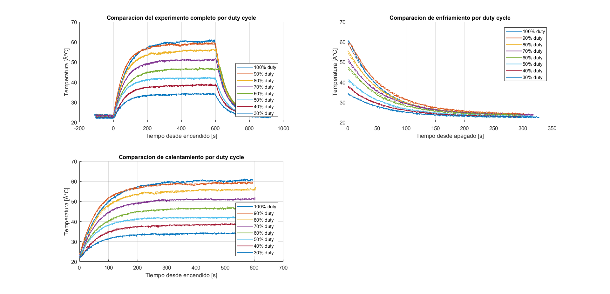

# Microcalentador para la detección de arsina

Microcalentador con control de temperatura para un sensor de arsina. El repositorio reúne el firmware y los scripts, el diseño de la placa, las simulaciones y las mediciones.

| Carpeta | Contenido |
|---|---|
| `Codigos/` | Firmware del controlador, scripts de MATLAB para identificar el modelo y scripts de Python para el análisis de curvas |
| `Kicad/` | Esquemático y placa del controlador de temperatura |
| `LTspice/` | Simulaciones |
| `Analisis/` | Informe completo, figuras y tablas del análisis de las curvas |
| `Imagenes/`, `Hoja de datos/`, `paper/` | Fotos, gráficas y documentación |

## Respuesta transitoria del microcalentador (encendido y apagado)

Se midió la temperatura del microcalentador con duty de 30, 40, 50, 60, 70, 80, 90 y 100 %: unos 10 min encendido y luego el enfriamiento, en dos configuraciones:

- **Aire libre:** sensor sobre la parte resistiva.
- **Dentro de la caja:** el microcalentador dentro de una caja, midiendo la temperatura de su interior.

**Parte resistiva, aire libre**



**Dentro de la caja**


### Conclusiones del transitorio

- **Encendido.** Las curvas suben a distintas velocidades porque el valor final es distinto: la pendiente inicial y el aumento final de temperatura son proporcionales al duty (≈ 0,40 °C por cada 1 % de duty al aire libre y ≈ 0,26 °C en la caja). El tiempo de respuesta no depende del duty. Al aire libre se comporta como un sistema de primer orden con τ ≈ 60–66 s. En la caja hay dos escalas de tiempo (≈ 60–80 s y ≈ 300–550 s) y a los 10 min todavía no llegó al régimen estacionario.
- **Apagado.** En valores absolutos lo más caliente se enfría más rápido, pero eso también ocurre en un sistema lineal. Normalizando, al aire libre el enfriamiento es más rápido cuanto mayor es la temperatura: el tiempo a la mitad baja de 48 s (ΔT de 12 °C) a 36 s (ΔT de 37 °C). En la caja no se detecta esa dependencia, y el enfriamiento tiene una cola lenta: tras unos 5 min la temperatura sigue 1,2–4,5 °C por encima de la inicial.
- **¿Es no lineal?** Levemente. Entre 30 y 90 % de duty el calentamiento es prácticamente lineal y el enfriamiento al aire libre muestra una no linealidad leve y sistemática. En la caja no se detecta no linealidad con la resolución de estos datos, aunque no se puede afirmar que sea lineal.
- **A tener en cuenta.** La corrida de 100 % al aire libre se aparta del resto (es más lenta que la de 90 % durante los primeros 3 min) y hay una sola corrida por duty, así que falta repetirla para saber si es real. Tampoco se midió la potencia: se supone proporcional al duty.

### Función de transferencia

Cada curva se ajustó con un modelo de primer orden (`Codigos/Matlab Modelo/construir_tf.m`):

- Encendido: `G_on(s) = K_on / (τ_on·s + 1)`, con `K_on` en °C (el aumento final de temperatura para ese duty) y `τ_on` en s.
- Apagado: `G_off(s) = 1 / (τ_off·s + 1)`, con `τ_off` en s.

**Para 100 % de duty**

| | Encendido | Apagado |
|---|---|---|
| Aire libre | `G_on(s) = 36,693 / (81,355·s + 1)` | `G_off(s) = 1 / (56,548·s + 1)` |
| Caja | `G_on(s) = 26,89 / (116,03·s + 1)` | `G_off(s) = 1 / (130,21·s + 1)` |

**Parte resistiva, aire libre**

| Duty [%] | K_on [°C] | τ_on [s] | τ_off [s] | T_amb [°C] | G_on(s) |
|---:|---:|---:|---:|---:|---|
| 100 | 36,693 | 81,355 | 56,548 | 23,658 | `36,693 / (81,355·s + 1)` |
| 90 | 35,373 | 65,085 | 66,869 | 23,483 | `35,373 / (65,085·s + 1)` |
| 80 | 32,303 | 72,815 | 63,468 | 23,336 | `32,303 / (72,815·s + 1)` |
| 70 | 27,813 | 71,551 | 65,861 | 23,248 | `27,813 / (71,551·s + 1)` |
| 60 | 23,95 | 74,366 | 70,117 | 22,567 | `23,95 / (74,366·s + 1)` |
| 50 | 19,382 | 61,978 | 68,129 | 22,578 | `19,382 / (61,978·s + 1)` |
| 40 | 15,919 | 73,312 | 66,356 | 22,53 | `15,919 / (73,312·s + 1)` |
| 30 | 11,922 | 67,811 | 72,854 | 22,109 | `11,922 / (67,811·s + 1)` |

**Dentro de la caja**

| Duty [%] | K_on [°C] | τ_on [s] | τ_off [s] | T_amb [°C] | G_on(s) |
|---:|---:|---:|---:|---:|---|
| 100 | 26,89 | 116,03 | 130,21 | 24,323 | `26,89 / (116,03·s + 1)` |
| 90 | 23,252 | 115,96 | 125,4 | 24,625 | `23,252 / (115,96·s + 1)` |
| 80 | 20,22 | 120,34 | 148,24 | 24,032 | `20,22 / (120,34·s + 1)` |
| 70 | 18,15 | 119,87 | 125,55 | 24,134 | `18,15 / (119,87·s + 1)` |
| 60 | 15,551 | 138,71 | 131,22 | 23,7 | `15,551 / (138,71·s + 1)` |
| 50 | 12,525 | 117,3 | 154,28 | 23,328 | `12,525 / (117,3·s + 1)` |
| 40 | 9,8572 | 124,09 | 126,49 | 23,1 | `9,8572 / (124,09·s + 1)` |
| 30 | 7,6401 | 116,94 | 140,92 | 22,901 | `7,6401 / (116,94·s + 1)` |

Son los valores que entrega `main_comparacion_duty.m`. En la caja el modelo de primer orden es una aproximación: la curva tiene dos escalas de tiempo, y los `t_on`/`t_off` que usa el script no coinciden con los datos en varias corridas (ver la sección 4 del informe).

El análisis completo, con el método, las tablas por duty y las limitaciones, está en [`Analisis/curvas_microcalentador.md`](Analisis/curvas_microcalentador.md). Para regenerar figuras y tablas:

```
python "Codigos/Python Analisis/figuras_analisis.py" . Analisis
```
